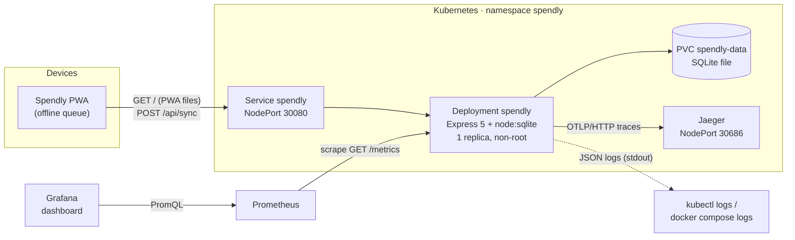
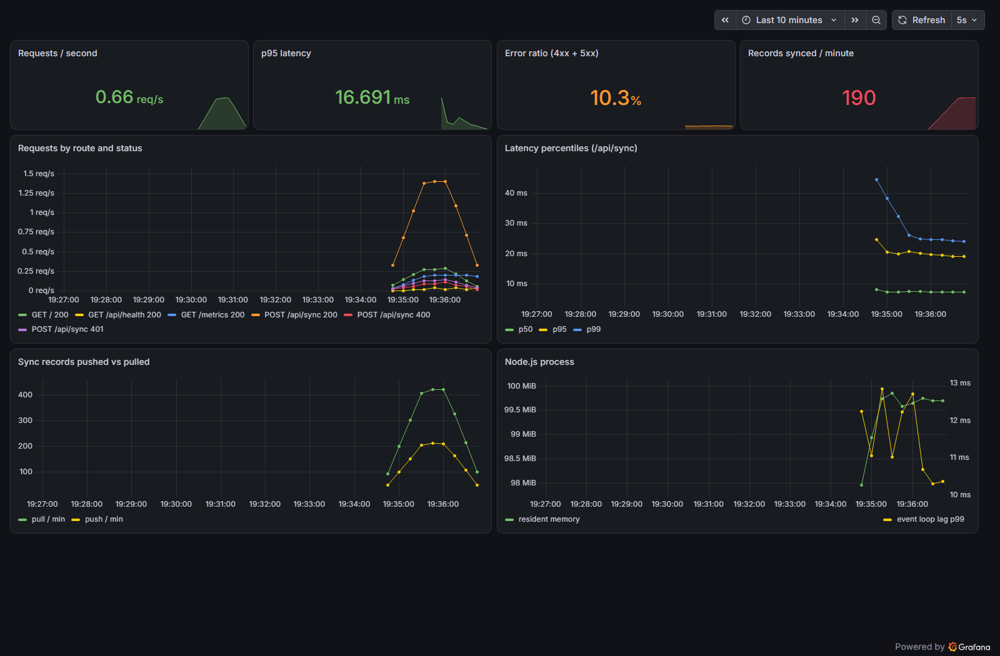
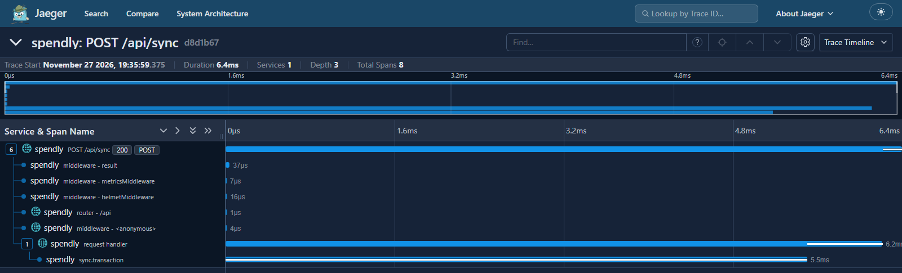
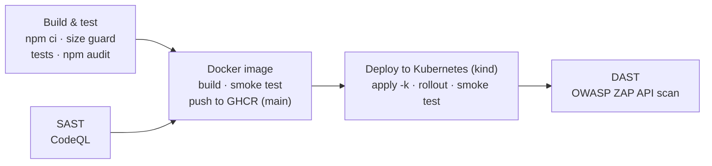
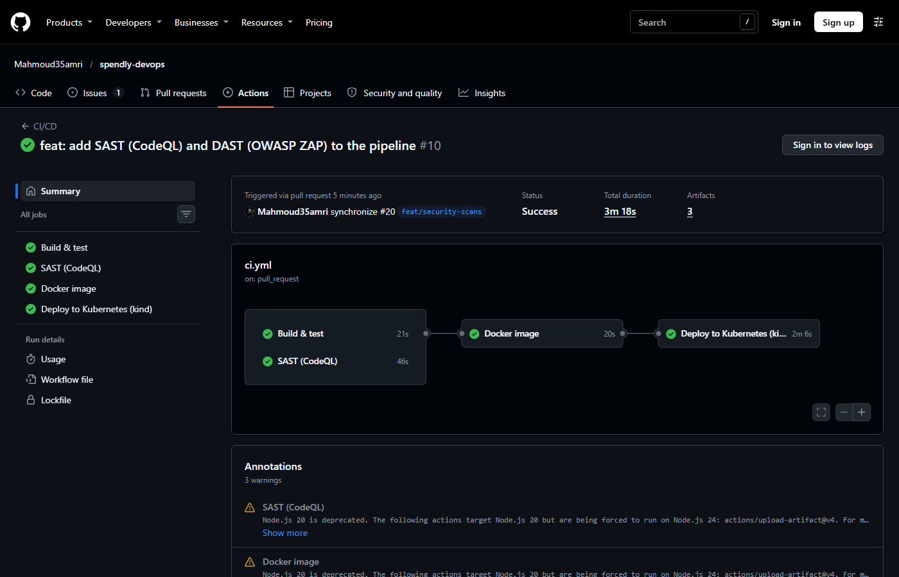

# Spendly: DevOps project

[](https://github.com/Mahmoud35amri/spendly-devops/actions/workflows/ci.yml)
[](https://github.com/Mahmoud35amri/spendly-devops/pkgs/container/spendly-devops)

**Spendly** is an offline-first expense tracker (a PWA for iPhone) with a small **sync API**. This repository is a copy of [Expenses-track](https://github.com/Mahmoud35amri/Expenses-track) in which the sync API was ported from Cloudflare Pages Functions to **Node.js (Express 5 + SQLite)**, then taken through a complete DevOps chain: CI/CD, Docker, Kubernetes, observability and security scans.

> The app's user guide (tiers, Back Tap quick-add, iPhone widget, budget tab) is in [docs/APP.md](docs/APP.md).
> The final report is in [docs/REPORT.md](docs/REPORT.md) ([PDF](docs/REPORT.pdf)), the presentation plan in [docs/PRESENTATION.md](docs/PRESENTATION.md).

## Contents

1. [Project requirements → where they are](#project-requirements--where-they-are)
2. [Architecture](#architecture)
3. [Repository layout](#repository-layout)
4. [Run it](#run-it): [locally](#1-locally-with-nodejs), [Docker](#2-docker), [docker compose + observability](#3-docker-compose-with-the-observability-stack), [Kubernetes](#4-kubernetes-kind)
5. [API](#api)
6. [Observability](#observability)
7. [Security](#security)
8. [CI/CD pipeline](#cicd-pipeline)
9. [GitHub workflow](#github-workflow)
10. [Configuration](#configuration)
11. [Troubleshooting](#troubleshooting)

## Project requirements → where they are

| Requirement | Implementation | Evidence |
|---|---|---|
| Tasks in GitHub Issues | One issue per task, labels + milestone *DevOps project delivery* | [Issues #8–#14](https://github.com/Mahmoud35amri/spendly-devops/issues?q=is%3Aissue+milestone%3A%22DevOps+project+delivery%22) |
| Small backend / REST API (< 150 lines) | `server/app.js` + `server/db.js`: **127 lines of code**, checked by CI | CI job summary *Backend size* |
| Git / GitHub | Feature branches, conventional commits, squash merges | [Commit history](https://github.com/Mahmoud35amri/spendly-devops/commits/main) |
| One PR per task + peer review | PRs #15–#22, each linked to its issue, merged only when CI is green; [peer review guide](docs/PEER_REVIEW.md) | [Pull requests](https://github.com/Mahmoud35amri/spendly-devops/pulls?q=is%3Apr) |
| CI/CD | GitHub Actions: build, test, scan, image, deploy, DAST | [Actions](https://github.com/Mahmoud35amri/spendly-devops/actions), [ci-pipeline.png](docs/evidence/ci-pipeline.png) |
| Metrics | `GET /metrics` (Prometheus): request count, duration histogram, records synced, Node.js runtime | [metrics-sample.txt](docs/evidence/metrics-sample.txt), [dashboard](docs/evidence/grafana-dashboard.png) |
| Structured logs | pino JSON, one line per request and error, with `trace_id` | [logs-sample.jsonl](docs/evidence/logs-sample.jsonl) |
| Tracing | OpenTelemetry → Jaeger (HTTP, Express, custom `sync.transaction` span) | [jaeger-trace.png](docs/evidence/jaeger-trace.png), [trace-sample.json](docs/evidence/trace-sample.json) |
| SAST | CodeQL `security-extended`, the build fails on any finding | [Security tab](https://github.com/Mahmoud35amri/spendly-devops/security/code-scanning), [SECURITY_SCANS.md](docs/evidence/SECURITY_SCANS.md) |
| DAST | OWASP ZAP API scan of the service deployed in Kubernetes | [zap-report.html](docs/evidence/zap-report.html), [SECURITY_SCANS.md](docs/evidence/SECURITY_SCANS.md) |
| Docker | [Dockerfile](Dockerfile), [docker-compose.yml](docker-compose.yml) | |
| Published image | GHCR, tags `latest` and `sha-<commit>`, pushed by CI on `main` | [Package page](https://github.com/Mahmoud35amri/spendly-devops/pkgs/container/spendly-devops) |
| Kubernetes | [k8s/](k8s/) manifests, deployed to a fresh kind cluster on every pipeline run | CI job *Deploy to Kubernetes (kind)*, [kubectl-state.txt](docs/evidence/kubectl-state.txt) |
| Documentation | This README, [openapi.yaml](openapi.yaml), [docs/](docs/) | |
| Final report | [docs/REPORT.md](docs/REPORT.md) ([PDF](docs/REPORT.pdf)) | |

## Architecture



- **One process serves both** the PWA files (an allowlist, never the server code or the database) and the API, so the app calls `/api/sync` on its own origin.
- **Sync**: each device sends the records it changed and receives everything changed after its cursor. In one SQLite transaction the server reserves revision numbers, upserts the changes (the newest `updatedAt` wins) and reads the next page (max 1000 records).
- **Privacy**: a random sync key identifies a vault; only its SHA-256 hash is stored.
- Prometheus and Grafana run in **docker compose**. In Kubernetes the app and Jaeger run, and `/metrics` is reachable through the Service (the pod also carries the usual `prometheus.io/*` scrape annotations).

## Repository layout

```
├── server/                  # the backend (Node.js, CommonJS)
│   ├── app.js               #   routes, validation, CORS, rate limit, security headers, static allowlist
│   ├── db.js                #   SQLite (node:sqlite) and the sync transaction
│   ├── observability.js     #   pino logs, Prometheus metrics, tracing helper
│   └── tracing.js           #   OpenTelemetry SDK, preloaded with --require
├── test/api.test.js         # integration tests (node:test, in-memory SQLite)
├── schema.sql               # tables (unchanged from the Cloudflare D1 version)
├── openapi.yaml             # API contract, also drives the DAST scan
├── Dockerfile, .dockerignore, docker-compose.yml
├── observability/           # Prometheus config, Grafana datasource + dashboard
├── k8s/                     # kind config + Kubernetes manifests (kustomize)
├── scripts/traffic.js       # traffic generator for demos and dashboards
├── .github/workflows/ci.yml # the whole pipeline
├── docs/                    # report, presentation, peer review guide, app guide, evidence
└── index.html, app.js, styles.css, icons.js, sw.js, manifest.webmanifest, icons/, widget/   # the PWA
```

## Run it

### Prerequisites

| Tool | Version | Needed for |
|---|---|---|
| Node.js | 22.13 or later (CI uses 24) | running locally, tests |
| Docker | Docker Desktop or Engine with compose v2 | containers, observability stack, kind |
| kind + kubectl | kind 0.20+ ([install](https://kind.sigs.k8s.io/docs/user/quick-start/#installation)), kubectl 1.30+ | Kubernetes |

### 1. Locally with Node.js

```sh
npm ci
npm start                      # http://localhost:3000 (PWA + API), data in data/spendly.db
npm test                       # 12 tests: API integration tests + widget self-check
```

Node 22 prints `ExperimentalWarning: SQLite is an experimental feature` once; Node 24 does not. Without a Jaeger to send to, tracing simply drops spans; set `OTEL_SDK_DISABLED=true` to turn it off.

### 2. Docker

```sh
docker build -t spendly .
docker run -d --name spendly -p 3000:3000 -v spendly-data:/data spendly
curl localhost:3000/api/health          # {"ok":true,"db":true}
docker logs -f spendly                  # JSON logs

# or the published image
docker run -d -p 3000:3000 -v spendly-data:/data ghcr.io/mahmoud35amri/spendly-devops:latest
```

The image runs as the unprivileged `node` user, contains only production dependencies and the files the service needs, and has a `HEALTHCHECK` (`docker ps` shows `healthy`).

### 3. docker compose with the observability stack

```sh
docker compose up -d --build
node scripts/traffic.js http://localhost:3000 120     # 2 minutes of realistic traffic
docker compose down                                   # add -v to delete the data volume
```

| Service | URL | What to look at |
|---|---|---|
| App | http://localhost:3000 | the PWA; `/api/health`, `/metrics` |
| Grafana | http://localhost:3001 | dashboard **Spendly API** (opens by default, no login) |
| Prometheus | http://localhost:9090 | *Status → Targets*: `spendly` is `UP` |
| Jaeger | http://localhost:16686 | service `spendly`, operation `POST /api/sync` |

### 4. Kubernetes (kind)

```sh
kind create cluster --config k8s/kind-config.yaml                         # cluster "spendly"
docker build -t ghcr.io/mahmoud35amri/spendly-devops:latest .
kind load docker-image ghcr.io/mahmoud35amri/spendly-devops:latest --name spendly
kubectl --context kind-spendly apply -k k8s
kubectl --context kind-spendly -n spendly rollout status deploy/spendly
kubectl --context kind-spendly -n spendly get pods,svc,pvc
```

- App: http://localhost:30080 · Jaeger UI: http://localhost:30686
- Logs: `kubectl --context kind-spendly -n spendly logs -f deploy/spendly`
- Data survives pod restarts: `kubectl --context kind-spendly -n spendly delete pod -l app=spendly`, then sync again
- Remove everything: `kind delete cluster --name spendly`

Skip the `docker build` / `kind load` lines to let the cluster pull the published image from GHCR instead. `--context kind-spendly` makes sure you never apply to another cluster by mistake.

| Manifest | Contents |
|---|---|
| [namespace.yaml](k8s/namespace.yaml) | namespace `spendly`, Pod Security **restricted** enforced |
| [config.yaml](k8s/config.yaml) | ConfigMap: log level, rate limit, OTLP endpoint (the app has no secrets) |
| [app.yaml](k8s/app.yaml) | PVC 1 Gi, Deployment (1 replica, `Recreate`, probes, limits, hardened securityContext), NodePort Service |
| [jaeger.yaml](k8s/jaeger.yaml) | Jaeger all-in-one + Service (OTLP 4318, UI 30686) |
| [kustomization.yaml](k8s/kustomization.yaml) | ties them together; CI pins the image tag to the commit |

## API

Full contract: [openapi.yaml](openapi.yaml) (paste it into [editor.swagger.io](https://editor.swagger.io) to browse it).

| Method | Path | Auth | Description |
|---|---|---|---|
| `GET` | `/api/health` | – | `{"ok":true,"db":true}`; used by Docker and Kubernetes probes |
| `POST` | `/api/sync` | `Authorization: Bearer <sync key>` | push changes, pull everything after `since` |
| `GET` | `/metrics` | – | Prometheus metrics |
| `GET` | `/`, `/app.js`, … | – | the PWA files (allowlist) |

**Push an expense and pull** (a sync key is any 32–128 characters of `A-Z a-z 0-9 _ -`):

```sh
KEY=$(openssl rand -hex 20)
curl -s -X POST localhost:3000/api/sync \
  -H "Authorization: Bearer $KEY" -H "Content-Type: application/json" \
  -d '{"since":0,"changes":[{"kind":"expense","id":"exp-1","updatedAt":1764240000000,"data":{"amount":4.5,"cat":"coffee"}}]}'
```
```json
{"cursor":1,"more":false,"records":[{"kind":"expense","id":"exp-1","deleted":false,"updatedAt":1764240000000,"rev":1,"data":{"amount":4.5,"cat":"coffee"}}]}
```

**Second device**: same key, `since` = its own last cursor; it only gets what changed after it:

```sh
curl -s -X POST localhost:3000/api/sync -H "Authorization: Bearer $KEY" -d '{"since":1}'
# {"cursor":1,"more":false,"records":[]}
```

**Delete** (a tombstone, synced like any change):

```sh
curl -s -X POST localhost:3000/api/sync -H "Authorization: Bearer $KEY" \
  -d '{"since":1,"changes":[{"kind":"expense","id":"exp-1","updatedAt":1764240099000,"deleted":true}]}'
# {"cursor":2,"more":false,"records":[{"kind":"expense","id":"exp-1","deleted":true,...,"data":null}]}
```

**Errors**

| Status | Body | When |
|---|---|---|
| 400 | `{"error":"invalid change"}` | unknown `kind`, empty or long `id`, bad `updatedAt` |
| 400 | `{"error":"invalid JSON"}` | malformed body |
| 401 | `{"error":"unauthorized"}` | missing or malformed sync key (checked before the body is read) |
| 413 | `{"error":"too many changes"}` / `{"error":"record too large"}` | more than 500 changes, or `data` over 4000 characters |
| 429 | rate limit message | more than 120 requests per minute per IP (`RATE_LIMIT_PER_MIN`) |

Rules: kinds are `expense`, `category`, `settings`, `entry`; an existing record is only replaced by a change with a **newer** `updatedAt` (last write wins); a pull returns at most 1000 records, and `more: true` means call again with the returned `cursor`.

## Observability

The three signals are linked: every log line carries the `trace_id` of its request, so a log line leads straight to its trace in Jaeger.

### Metrics: `GET /metrics`

| Metric | Type | Labels | Meaning |
|---|---|---|---|
| `http_requests_total` | counter | `method`, `route`, `status` | request count |
| `http_request_duration_seconds` | histogram | `method`, `route`, `status` | response time (buckets 5 ms to 2.5 s) |
| `spendly_sync_records_total` | counter | `direction` = `push` / `pull` | records synced (business metric) |
| `process_*`, `nodejs_*` | various | | memory, CPU, event-loop lag, GC (prom-client defaults) |

`route` is the route **template** (`/api/sync`), never the raw URL, so the number of time series stays bounded. Unknown paths are grouped as `unmatched`.

The Grafana dashboard [observability/grafana/dashboards/spendly.json](observability/grafana/dashboards/spendly.json) is provisioned automatically: request rate, p95 latency, error ratio, records synced per minute, requests by route and status, p50/p95/p99 of `/api/sync`, push vs pull, memory and event-loop lag.



### Logs

[pino](https://getpino.io) writes one JSON line per request to stdout (`kubectl logs` / `docker compose logs`): 2xx → `info` (30), 4xx → `warn` (40), 5xx → `error` (50) with the stack trace. Request fields come from an **allowlist** (id, method, url, ip, user agent), so headers, and with them the sync key, never reach the logs. Health probes and Prometheus scrapes are not logged.

```json
{"level":40,"time":1795803068649,"pid":1,"hostname":"spendly-756d58c644-l4t66","req":{"id":5,"method":"POST","url":"/api/sync","ip":"::ffff:10.244.0.1","userAgent":"curl/8.10.1"},"trace_id":"56c572fca919954fdb10924933b8fa83","span_id":"70b32337583e311a","trace_flags":"01","res":{"statusCode":401},"responseTime":1,"msg":"request completed"}
```

More in [docs/evidence/logs-sample.jsonl](docs/evidence/logs-sample.jsonl).

### Tracing

[server/tracing.js](server/tracing.js) starts the OpenTelemetry SDK before the app loads (`node --require ./server/tracing.js`), with HTTP, Express and pino instrumentation. A manual span `sync.transaction` measures the SQLite work and records the number of pushed changes and the cursor. Spans go over OTLP/HTTP to Jaeger (`OTEL_EXPORTER_OTLP_ENDPOINT`); in Kubernetes they also carry the pod name.



## Security

| Layer | Control |
|---|---|
| **SAST** | CodeQL (`security-extended`) on every push and PR; results in the [Security tab](https://github.com/Mahmoud35amri/spendly-devops/security/code-scanning); **any finding fails the build** |
| **DAST** | OWASP ZAP API scan (driven by `openapi.yaml`, authenticated) against the service **deployed in Kubernetes**; **High risk alerts fail the build**; HTML/JSON/Markdown reports as artifacts |
| **Dependencies** | `npm audit --omit=dev --audit-level=high` in CI |
| **API** | sync key checked before the body is parsed; strict validation (kinds, sizes, counts); body limit 3 MB; per-IP rate limit; only the key's SHA-256 is stored; parameterized SQL only |
| **HTTP** | helmet: CSP (`script-src 'self'`), `X-Content-Type-Options`, `X-Frame-Options`, `Referrer-Policy`, no `X-Powered-By`; CORS limited to known origins |
| **Static files** | explicit allowlist: `server/`, `data/`, `package.json` and `.git` are never served (tested) |
| **Logs** | field allowlist: the `Authorization` header is never logged |
| **Container** | non-root user, production dependencies only, minimal file set |
| **Kubernetes** | Pod Security `restricted`, `runAsNonRoot`, `readOnlyRootFilesystem`, all capabilities dropped, no privilege escalation, seccomp `RuntimeDefault`, resource limits |

Scan results and how each finding was handled: [docs/evidence/SECURITY_SCANS.md](docs/evidence/SECURITY_SCANS.md).

## CI/CD pipeline

[.github/workflows/ci.yml](.github/workflows/ci.yml) runs on every pull request and every push to `main`.



| Job | Steps | Fails when |
|---|---|---|
| **Build & test** | `npm ci`; size guard (API ≤ 150 lines of code); `node --test` (API tests + widget self-check); `npm audit` | a test fails, the API grows past 150 lines, a high-severity vulnerable dependency |
| **SAST (CodeQL)** | CodeQL init + analyze, SARIF to the Security tab and as an artifact, findings in the job summary | any CodeQL finding |
| **Docker image** | build `latest` + `sha-<commit>`, start the container and wait for `/api/health`, save the image for the next job; **on `main`**: push both tags to `ghcr.io` | the build fails or the container never becomes healthy |
| **Deploy to Kubernetes (kind)** | create a kind cluster, load *this* image, pin the kustomization to `sha-<commit>`, `kubectl apply -k`, wait for the rollouts, smoke test (health, sync, metrics, traces in Jaeger), then the **DAST** scan | rollout timeout, failed smoke test, High risk ZAP alert |

Each job writes a short summary on the run page (size, CodeQL findings, published tags, ZAP alerts). Artifacts: `codeql-sarif`, `zap-report`.



The deployment target is a fresh kind cluster in the runner on every run (the brief's local Kubernetes). Moving to a cloud cluster would replace the kind steps with cluster credentials and a `kubectl apply -k k8s` on `main` only.

## GitHub workflow

1. Every task is an **issue** (labels `backend`, `ci-cd`, `docker`, `observability`, `kubernetes`, `security`, `docs`; milestone *DevOps project delivery*).
2. One **branch per issue** (`feat/…`, `ci/…`, `docs/…`) and **conventional commits** (`feat:`, `fix:`, `ci:`, `docs:`).
3. One **pull request per issue**, using the [PR template](.github/pull_request_template.md) (what, why, how tested, review focus) and `Closes #n`.
4. The pipeline must be **green** before merge; merges are squashed so `main` has one commit per task.
5. **Peer review**: [docs/PEER_REVIEW.md](docs/PEER_REVIEW.md) explains how to request and give a review, with a checklist and examples of constructive comments.

| Issue | PR | Topic |
|---|---|---|
| #8 | #15 | Port the sync API to Node (< 150 lines) |
| #9 | #16 | CI: build, test, size guard, audit |
| #10 | #17 | Docker + compose + GHCR |
| #11 | #18 | Metrics, logs, tracing, Grafana |
| #12 | #19 | Kubernetes + kind deploy in CI |
| #13 | #20 | SAST + DAST |
| #9 | #21 | CI: artifact actions on Node 24 |
| #14 | #22 | Documentation, report, evidence |

(Issues #1–#7 belonged to a first attempt on another codebase and were closed as *not planned*.)

## Configuration

| Variable | Default | Purpose |
|---|---|---|
| `PORT` | `3000` | HTTP port |
| `DB_PATH` | `data/spendly.db` (`/data/spendly.db` in the image) | SQLite file; `:memory:` for tests |
| `RATE_LIMIT_PER_MIN` | `120` | requests per minute per IP (every route except `/api/health` and `/metrics`) |
| `LOG_LEVEL` | `info` | pino level (`silent` in tests) |
| `OTEL_SERVICE_NAME` | `spendly` (image) | service name in traces |
| `OTEL_EXPORTER_OTLP_ENDPOINT` | `http://localhost:4318` | where traces go (Jaeger) |
| `OTEL_SDK_DISABLED` | unset | `true` turns tracing off |

## Troubleshooting

| Symptom | Fix |
|---|---|
| `kind create cluster` fails with `ports are not available` | another program uses 30080 or 30686: change `hostPort` in [k8s/kind-config.yaml](k8s/kind-config.yaml) |
| `kubectl` talks to the wrong cluster | always pass `--context kind-spendly` (list them with `kubectl config get-contexts`) |
| Pod stuck in `ImagePullBackOff` | run the `kind load docker-image` step, or check the image tag in `k8s/kustomization.yaml` |
| No traces in Jaeger | spans are sent in batches every ~5 s; check `OTEL_EXPORTER_OTLP_ENDPOINT` and that the app was started with `--require ./server/tracing.js` (`npm start` and the image do) |
| Grafana shows "No data" | run `node scripts/traffic.js`; check Prometheus *Status → Targets* |
| `429 Too Many Requests` | raise `RATE_LIMIT_PER_MIN` |
| `ExperimentalWarning: SQLite` | harmless on Node 22; use Node 24 |
