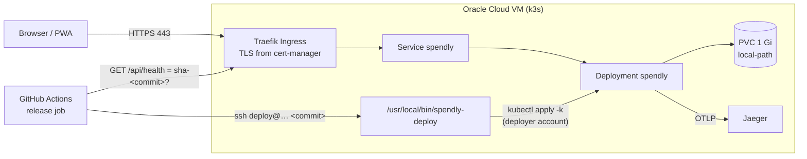

# Production: k3s on Oracle Cloud

**https://spendly.mahmoudamri.me** runs on a single-node [k3s](https://k3s.io) cluster on an Oracle Cloud *Always Free* VM. It uses the same manifests as the kind cluster, plus an HTTPS Ingress. Every commit merged to `main` that passes the whole pipeline is released there automatically.

| | |
|---|---|
| VM | `VM.Standard.A1.Flex` (Ampere ARM, 1 OCPU, 6 GB), Ubuntu 24.04, region `eu-paris-1` |
| Kubernetes | k3s v1.37 (containerd, Traefik ingress, local-path storage, metrics-server) |
| TLS | cert-manager v1.21 + Let's Encrypt (HTTP-01), renewed automatically |
| DNS | `spendly` A record → the VM's public IP (Namecheap) |
| Image | `ghcr.io/mahmoud35amri/spendly-devops:sha-<commit>`, multi-arch (amd64 + arm64) |



## How a release works

1. A pull request is merged into `main`. CI runs tests, SAST, builds the image, deploys it to a fresh kind cluster and runs the DAST scan. On `main` it also pushes the image to GHCR for amd64 and arm64.
2. The **release** job (GitHub environment `production`) runs only if all of that passed. It connects with `ssh deploy@spendly.mahmoudamri.me <commit SHA>`.
3. On the server that key can only run [`spendly-deploy`](../k8s/production/deploy.sh), its *forced command*. The script:
   - rejects anything that isn't a full commit SHA;
   - fetches `main` and refuses a commit that isn't on it;
   - checks out that commit and pins the image to `sha-<commit>`;
   - runs `kubectl apply -k k8s/production` and waits for the rollout.
4. The job then polls `https://spendly.mahmoudamri.me/api/health` until `version` equals `sha-<commit>`: production is confirmed to serve the commit that was tested.

Rollback means reverting the change on `main`, or running `spendly-deploy <older commit of main>` on the server.

## Moving from the Cloudflare server

Before this deployment, the app synced with a Cloudflare Pages Function and its D1 database (`https://spendly-m35a.pages.dev/api`). Existing devices and device links (`…#link=<sync key>`) carry over with no export step:

1. **Server: import on first contact.** The production ConfigMap sets `LEGACY_API` to the old API. The first time the new server sees a sync key, it pulls that key's records from the old API with the same key, page by page, and stores them. Then it answers the request. If the old API fails, the request fails (500) before the vault exists, and the device's next sync retries. A key seen once is never imported again.
2. **Client: re-upload on a server change.** Revision cursors only mean something on the server that issued them. When the app's sync server changes, it starts again from cursor 0 and re-uploads everything it holds once. The server keeps the newest copy of each record (`updatedAt`), so a change a device sent to the old server just before switching is not lost.
3. **One backend.** The original app at `mahmoud35amri.github.io/Expenses-track` syncs with `https://spendly.mahmoudamri.me/api` too (CORS allows that origin), so every device shares the same data. The D1 database stays as it was, read-only in practice, as a backup.

Opening an old device link on the new site works: replace `https://mahmoud35amri.github.io/Expenses-track/` with `https://spendly.mahmoudamri.me/`, or use *Paste a device link* in the app's settings. Once every device has synced, `LEGACY_API` can be removed. Until then, each new key costs one request to the old API, and the rate limit bounds that.

## Security boundaries

| Who | Can do | Cannot do |
|---|---|---|
| CI's SSH key (`DEPLOY_SSH_KEY` secret) | run `spendly-deploy` with a commit of `main` | open a shell, forward ports, deploy unreviewed code |
| `deploy` Linux user | read `/opt/spendly` (public repo) and its own kubeconfig | read other users' files, use `sudo` |
| `deployer` ServiceAccount | manage everything in namespace `spendly` (ClusterRole `admin` through a RoleBinding) | touch other namespaces, cluster-wide objects or the namespace's Pod Security label |
| Pods in `spendly` | what Pod Security **restricted** allows | run privileged, mount host paths, run as root |

Network: the VCN security list and the host firewall allow only 22 (SSH), 80 and 443. The NodePorts (30080, 30686) are not reachable from outside. The Jaeger UI is reached through an SSH tunnel: `ssh -L 16686:localhost:30686 pfe-server`, then http://localhost:16686.

## One-time setup (already done; to rebuild the server)

```sh
# 1. Oracle Cloud: VCN security list → ingress TCP 80 and 443 from 0.0.0.0/0.
# 2. Host firewall: Oracle's Ubuntu image rejects everything but SSH. Allow web traffic and k3s pod traffic,
#    before the REJECT lines in /etc/iptables/rules.v4, then apply the same rules live:
#      -A INPUT -p tcp -m state --state NEW -m tcp --dport 80 -j ACCEPT
#      -A INPUT -p tcp -m state --state NEW -m tcp --dport 443 -j ACCEPT
#      -A INPUT -s 10.42.0.0/16 -j ACCEPT          # pods → node (API server, DNS)
#      -A FORWARD -s 10.42.0.0/16 -j ACCEPT
#      -A FORWARD -d 10.42.0.0/16 -j ACCEPT
# 3. k3s and cert-manager
curl -sfL https://get.k3s.io | sudo INSTALL_K3S_VERSION="v1.37.2+k3s1" sh -s - --write-kubeconfig-mode 600
sudo k3s kubectl apply -f https://github.com/cert-manager/cert-manager/releases/download/v1.21.3/cert-manager.yaml
# 4. Deploy user and repository
sudo useradd --create-home --shell /bin/bash deploy
sudo install -d -o deploy -g deploy /opt/spendly
sudo -u deploy git clone https://github.com/Mahmoud35amri/spendly-devops.git /opt/spendly
# 5. Cluster-wide pieces (admin): namespace, ClusterIssuer, HTTPS redirect, Traefik client IP, deployer account
sudo k3s kubectl apply -f /opt/spendly/k8s/namespace.yaml -f /opt/spendly/k8s/production/cluster/
# 6. ~deploy/.kube/config with the deployer token (secret deployer-token in namespace spendly), server https://127.0.0.1:6443
# 7. Deploy script and CI key
sudo install -m 755 /opt/spendly/k8s/production/deploy.sh /usr/local/bin/spendly-deploy
#    ~deploy/.ssh/authorized_keys:  command="/usr/local/bin/spendly-deploy",restrict ssh-ed25519 AAAA… spendly-ci-deploy
# 8. GitHub: secret DEPLOY_SSH_KEY = the private key; variable DEPLOY_KNOWN_HOSTS = "spendly.mahmoudamri.me ssh-ed25519 AAAA…"
```

## Operating it

```sh
ssh pfe-server
sudo k3s kubectl -n spendly get pods,ingress,certificate,pvc
sudo k3s kubectl -n spendly logs -f deploy/spendly          # JSON logs
sudo k3s kubectl -n spendly top pod                         # CPU / memory (metrics-server)
sudo k3s kubectl -n spendly describe certificate spendly-tls
```

Data lives in the PVC (`/var/lib/rancher/k3s/storage/pvc-…` on the VM) and survives pod restarts and releases. Back it up with `sudo k3s kubectl -n spendly exec deploy/spendly -- cat /data/spendly.db > spendly-backup.db`. This copies the file while the app runs; use it only when nobody is syncing.

## Limits

- **One node**: a VM reboot or k3s upgrade means a short outage. SQLite (single writer, `ReadWriteOnce`) is also why the app runs one replica.
- **Shared VM**: the server runs another, unrelated service. Isolation relies on the namespace RBAC and Pod Security above, and on the `deploy` user having no access to that service's files.
