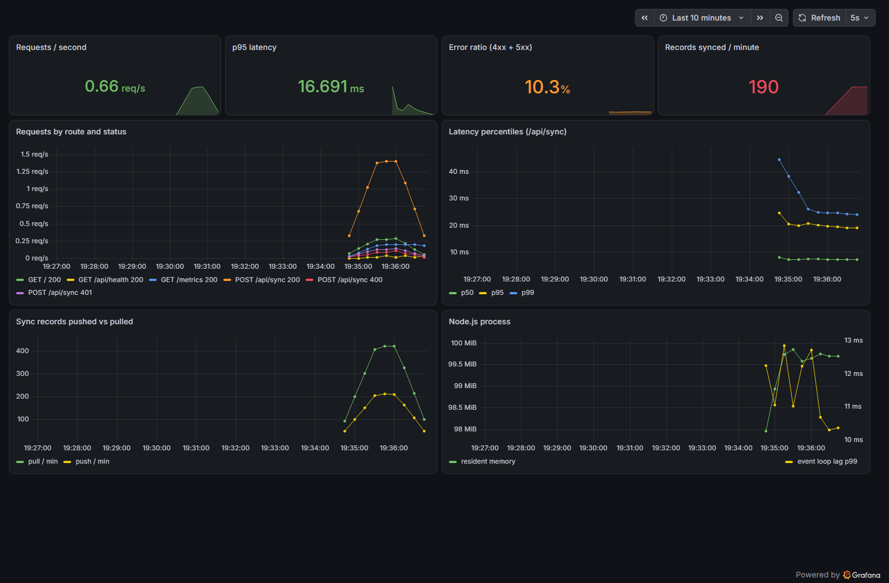
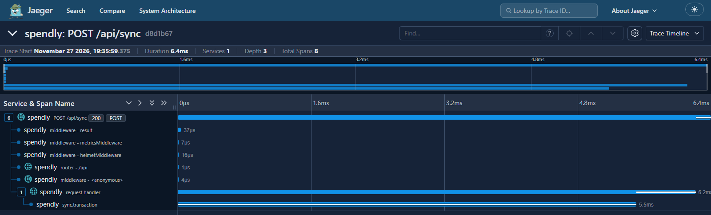

# Spendly: DevOps project report

**Mahmoud Amri** · Repository: [github.com/Mahmoud35amri/spendly-devops](https://github.com/Mahmoud35amri/spendly-devops) · Image: `ghcr.io/mahmoud35amri/spendly-devops` · Live: **https://spendly.mahmoudamri.me**

## 1. Service and architecture

Spendly is an offline-first expense tracker (PWA). Every change is stored on the phone first and queued; a **sync API** then pushes the queued changes and pulls those made on other devices. The original API ran as a Cloudflare Pages Function on D1. Because that runtime cannot be containerized, deployed to Kubernetes or scraped by Prometheus, I **ported it to Node.js**: Express 5 and SQLite through Node's built-in `node:sqlite`. The contract stayed identical (`POST /api/sync`, `GET /api/health`, same JSON and status codes), so the PWA needed no change, and the SQL is unchanged because D1 is SQLite.

The API is **148 lines of code** (`server/app.js` + `server/db.js`, enforced < 150 by CI). One sync is one SQLite transaction: reserve *n* revision numbers (`INSERT … ON CONFLICT … RETURNING`), upsert each change only if its `updatedAt` is newer (last write wins), and return everything after the client's cursor, 1000 records per page. A sync key identifies a private vault; only its SHA-256 hash is stored. The same process serves the PWA files from an allowlist.

**Runtime view:** device → Service (NodePort 30080) → pod (Express + SQLite on a PersistentVolumeClaim) → OTLP traces to Jaeger; Prometheus scrapes `/metrics`; Grafana reads Prometheus.

## 2. Tools

| Area | Tools |
|---|---|
| Code, tests | Node.js 24, Express 5, `node:sqlite`, `node:test` (13 integration tests on in-memory SQLite) |
| Workflow | GitHub Issues (#8–#14, #25), one branch + PR per task (#15–#26), PR template, squash merges, branch protection |
| CI/CD, cloud | GitHub Actions, GHCR (amd64 + arm64), kind, kustomize; k3s on Oracle Cloud, Traefik, cert-manager + Let's Encrypt |
| Containers | Docker (single-stage `node:24-alpine`), docker compose |
| Observability | prom-client, Prometheus 3, Grafana 13, pino, OpenTelemetry SDK, Jaeger 2 |
| Security | CodeQL (SAST), OWASP ZAP (DAST), `npm audit`, helmet, express-rate-limit, Pod Security Standards |

## 3. CI/CD pipeline

One workflow runs on every PR and every push to `main`: **Build & test** (install, size guard, tests, `npm audit`) and **SAST** (CodeQL) in parallel → **Docker image** (build, start the container and wait for `/api/health`; on `main`, push `latest` and `sha-<commit>` to GHCR) → **Deploy to Kubernetes** (create a kind cluster, load *the image built in this run*, pin the kustomization to `sha-<commit>`, `kubectl apply -k`, wait for the rollout, smoke-test health, sync, metrics and trace export) → **DAST** (ZAP against that deployment). On `main` only, **Release** deploys the same commit to production and passes only when `https://spendly.mahmoudamri.me/api/health` reports `sha-<commit>`. Each job writes a summary; a PR can only be merged when everything is green.

## 4. Observability

- **Metrics** (`/metrics`): `http_requests_total` and `http_request_duration_seconds` by method, *route template* and status (never raw URLs, to keep cardinality bounded), the business counter `spendly_sync_records_total{direction}`, and Node.js runtime metrics. A provisioned Grafana dashboard shows rate, p95 latency, error ratio, records synced, latency percentiles, memory and event-loop lag.
- **Logs**: pino JSON, one line per request (4xx `warn`, 5xx `error` with stack). Fields come from an allowlist, so the `Authorization` header (the sync key) is never logged; probes and scrapes are skipped.
- **Tracing**: the OpenTelemetry SDK is preloaded with `--require`; HTTP, Express and pino are instrumented, plus a manual `sync.transaction` span around the SQLite work. Pino instrumentation adds `trace_id` to every log line, which links a log line to its trace in Jaeger. Evidence: `docs/evidence/` (dashboard and trace screenshots, sample logs, metrics, trace JSON).

<table><tr>
<td width="56%"> <em>Figure 1. Grafana dashboard during a traffic run</em></td>
<td width="44%"> <em>Figure 2. One <code>POST /api/sync</code> in Jaeger: 8 spans down to <code>sync.transaction</code></em></td>
</tr></table>

## 5. Security

**SAST:** CodeQL `security-extended`. The first run found 3 issues: two routes serving files without a rate limit, and a hostname check in the PWA (`endsWith('github.io')`, which `evilgithub.io` would pass). All three were fixed. The gate initially missed them because it filtered on `level: error`, which CodeQL leaves unset; it now fails on any finding. The first full scan of `main` then found a **stored XSS in the PWA**: the currency setting syncs between devices and was inserted into `innerHTML` (plus a synced tier budget written into an attribute unescaped). Both were fixed; PR runs had missed it because CodeQL only reports changed lines on pull requests, so PRs now get the full analysis too. **DAST:** ZAP API scan, driven by `openapi.yaml` and authenticated, against the live Kubernetes deployment: 119 rules passed, **0 High, 0 Medium**, 1 Low (HTML at `/`, expected) and 2 informational alerts; no payload produced a 5xx. **Built in:** the key is checked before the body is parsed; strict validation and size limits; parameterized SQL; CSP and security headers; CORS allowlist; a static-file allowlist (tests prove `server/`, `data/` and `.git` are never served); non-root image; Pod Security `restricted` with a read-only root filesystem and no capabilities.

## 6. Kubernetes

The manifests in `k8s/` are applied with `kubectl apply -k k8s`: a namespace with the **restricted** Pod Security level, a ConfigMap (no Secret is needed: keys live on devices), a 1 Gi PVC, the app Deployment (readiness and liveness probes on `/api/health`, requests and limits, `runAsNonRoot`, `readOnlyRootFilesystem`, seccomp), a NodePort Service, and Jaeger. Because SQLite allows a single writer on a `ReadWriteOnce` volume, the Deployment runs **1 replica with the `Recreate` strategy**; deleting the pod proves the data survives. kind publishes the NodePorts on `localhost:30080` (app) and `localhost:30686` (Jaeger).

**Cloud (bonus).** The same base manifests run on a single-node **k3s cluster on an Oracle Cloud ARM VM**. A `production` overlay adds an Ingress (Traefik) with a Let's Encrypt certificate (cert-manager) and trusts one proxy hop for the client IP. CI deploys over SSH with a key whose *forced command* can only deploy a commit already on `main`. The account behind it is limited to the `spendly` namespace, where Pod Security `restricted` forbids host access. Existing users moved over automatically: the first sync of a key imports its records from the old Cloudflare API, and the app re-uploads its data once when its sync server changes.

## 7. Lessons learned

1. **Rate limiting can break Kubernetes.** NodePort traffic is rewritten to the node's IP, the same IP the kubelet probes from. A limiter on `/api/health` would have answered probes with 429 under load (DAST is exactly that load) and pulled the pod out of service. The limiter now skips probes and scrapes, and a test guards it.
2. **Check that your security gate can fail, and what it looks at.** My first CodeQL gate passed with 3 findings because of how SARIF encodes severity, and PR runs only looked at changed lines, hiding an XSS in older code until `main` was scanned.
3. **Pin versions and read release notes.** Jaeger 2.23 dropped its legacy `/api`, so Grafana's Jaeger datasource and my first trace queries got 404s; `/api/v3` works.
4. **Observability needs restraint.** The default HTTP logger wrote every header (including the sync key) and 1.5 KB per line; an allowlist fixed both. Labelling metrics by route template instead of the URL avoids unbounded series.
5. **Portability is a design choice.** The Cloudflare version was simpler to deploy but impossible to containerize or observe. Keeping the contract stable made the port safe.

**Next steps:** Postgres to allow several replicas, GitOps (Argo CD) instead of the SSH push, Prometheus Operator with alerting in the cloud cluster, image signing (cosign) and digest pinning.
